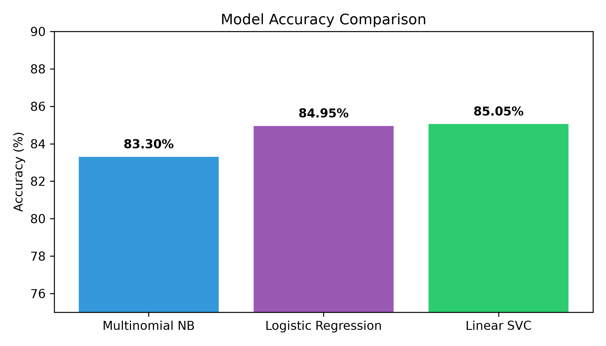
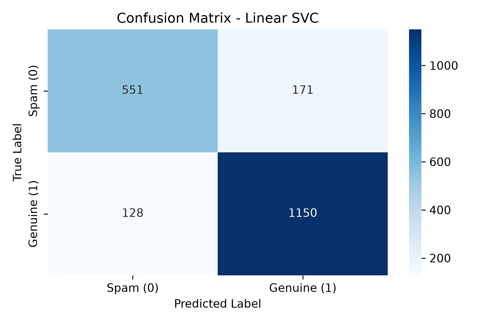

# 🛒 Amazon Review Spam Detection

An end-to-end Machine Learning pipeline to identify genuine vs. spam/fake reviews from Amazon's **Cell Phones and Accessories** category using Natural Language Processing (NLP).

---

## 📌 Project Overview
- **Objective:** Classify customer reviews into **Genuine (Class 1)** or **Spam / Low-Quality (Class 0)**.
- **Dataset:** Amazon Cell Phones and Accessories reviews (JSON format).
- **Core Techniques:** Text Preprocessing, TF-IDF Vectorization, Machine Learning Classification, Confusion Matrix Analysis.

---

## 📊 Model Performance Comparison

| Model | Accuracy |
| :--- | :--- |
| **Multinomial Naive Bayes** | 83.30% |
| **Logistic Regression** | 84.95% |
| **Linear SVC (Best Model)** | **85.05%** |

---

## 📈 Evaluation & Results
- **Best Classifier:** `LinearSVC` with TF-IDF unigram & bigram features (`ngram_range=(1, 2)`).
- **High Precision:** Correctly identified over 1,240 positive/genuine reviews with minimal false positives.
- Saved deployment pipeline file: `best_spam_detector_model.pkl`.

---

## 🛠️ Tech Stack & Libraries
- **Language:** Python
- **Data Manipulation:** Pandas
- **Machine Learning & NLP:** Scikit-learn (`TfidfVectorizer`, `LinearSVC`, `MultinomialNB`, `LogisticRegression`)
- **Model Serialization:** Joblib
- **Visualization:** Matplotlib, Seaborn
-### 📈 Visual Evaluation

